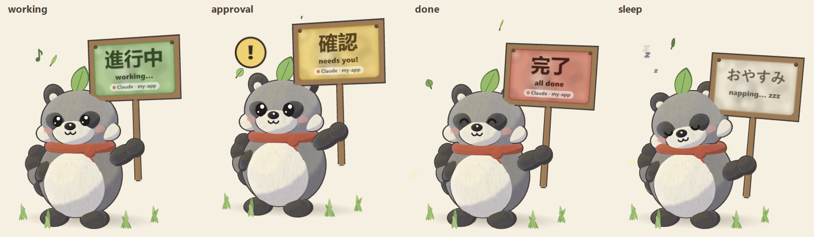

<p align="center"></p>

<h1 align="center">Tanuki Buddy 🍃</h1>

<p align="center">A cozy, hand-painted forest tanuki that sits in the corner of your Windows desktop and holds up a sign showing what your <b>Claude Code</b> and <b>Codex</b> sessions are doing.</p>

<p align="center"></p>

| Sign | Meaning | What the tanuki does |
|---|---|---|
| 🟢 **進行中 · working…** | a session is busy | hums and sways, with a ♪ |
| 🟡 **確認 · needs you!** | a session wants a permission approval, or is asking you a question | hops, waves the sign, wind-chime, Windows notification |
| 🔴 **完了 · all done** | a session finished its turn and is waiting for your next prompt | stretches with happy eyes, soft chime |
| ⚪ **おやすみ · napping** | no activity for 30 minutes | dozes off with zzz |

If several sessions are open, the most urgent one wins (yellow > green > red), and the sign shows `+N`.
Hover over the tanuki to see every session. Drag it anywhere, click it to poke it, and right-click for the menu.

**Hide it under the log.** Hover the tanuki and press the little log button: it hops, dives under a mossy log tied with a shimenawa rope, and leaves a small flag waving in the status colour (it flaps hard when something needs you). Click the log, or open Tanuki Buddy from its desktop icon, to bring it back out.

**Resize it.** Hover the tanuki and drag the ⤡ button: up/left to grow, down/right to shrink. Double-click it to reset.

## Download (Windows)

1. Download **`Tanuki-Buddy-Setup-x.y.z.exe`** from the [latest release](https://github.com/SachchitBalamurugan/tanuki-buddy/releases/latest).
2. Run it. It installs just for you (no admin needed), adds a desktop icon, and starts right away.
   - The installer isn't code-signed, so Windows SmartScreen may warn you. Click **More info → Run anyway**.
3. Right-click the tanuki, or the leaf icon in the tray, and choose **Connect Claude & Codex…**.

That's it: start a Claude Code or Codex session and watch the sign.

**Requirements:** Windows 10/11 x64, and [Node.js](https://nodejs.org) on your PATH. The hooks use Node to talk to the tanuki; you almost certainly already have it if you use Claude Code or Codex.

## What "Connect" does

It merges a few hook entries into `~/.claude/settings.json` and `~/.codex/hooks.json`:
- Your existing hooks are kept, and each file is backed up to `*.bak-tanuki` first.
- **Disconnect**, in the same menu, removes only the tanuki's entries.
- Codex may ask you once to trust the new hooks.

The hook bridge (`hooks/send.mjs`) only sends a tiny status message to `127.0.0.1:47321`.
It never prints anything and always exits 0, so it can't block, approve, or deny anything.
If the app isn't running, it does nothing.

| Hook event | → state |
|---|---|
| `UserPromptSubmit`, `PreToolUse`, `PostToolUse` | working |
| `PreToolUse` for `AskUserQuestion` / `ExitPlanMode`, `PermissionRequest`, `Notification` (permission) | needs you |
| `Stop`, `SessionStart`, `Notification` (idle) | done |
| `SessionEnd` | session removed |

## Tray menu

Hide under the log, size (small / medium / large), reset position, wind-chime sound, Windows notifications, **Start with Windows**, connect/disconnect, test states, quit.

## Develop

```bash
npm install
npm start                            # run from source
npm run install-hooks -- --dry-run   # preview the hook change (writes nothing)
npm run install-hooks                # point hooks at this checkout
npm run uninstall-hooks
npm run dist                         # build dist/Tanuki-Buddy-Setup-<version>.exe
```

Debug helpers:
- `curl 127.0.0.1:47321/status` shows the current aggregated state.
- `npx electron . --snapshot=./snaps` renders each state to a PNG and quits.
- `npx electron . --icon=build/icon.png` re-renders the app icon.

## How it's made

- **Electron** runs a transparent, always-on-top, click-through window, plus the tray and a loopback HTTP endpoint.
- **Three.js** draws the tanuki. It's built entirely from primitives in code, with no model files.
  - A custom hand-painted shader gives it soft watercolor shadow edges, cool lilac shadows, warm sunlight, pigment pooling and brushed fur.
  - Inverted-hull outlines give it warm ink lines.
- **GSAP** timelines drive every mood. Motion respects `prefers-reduced-motion`.
- **WebAudio** synthesizes a fūrin (wind-bell) chime, so there are no audio files.

The character is an original design inspired by Japanese countryside folklore. MIT licensed.
